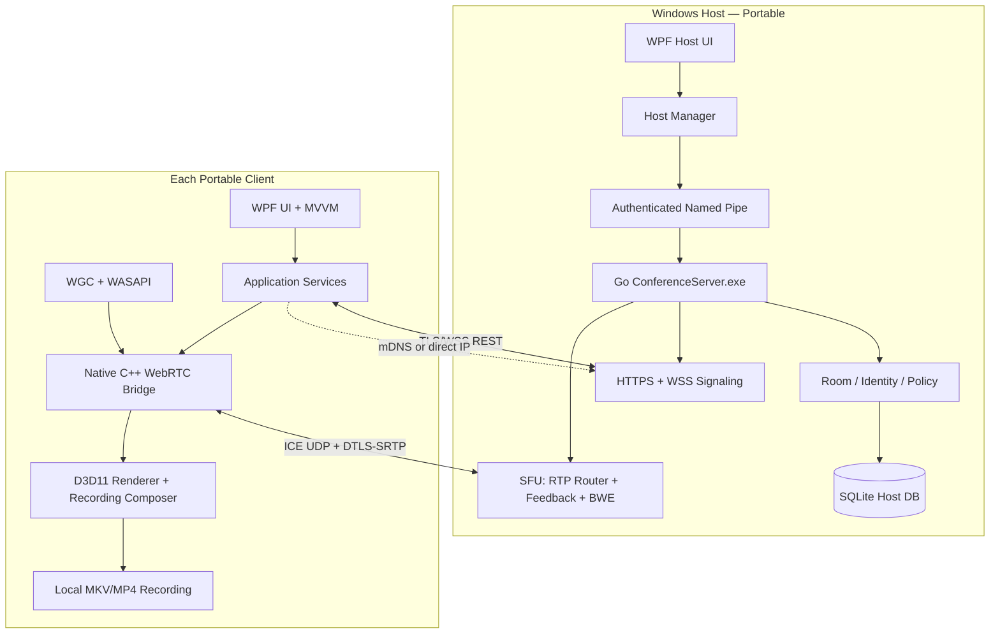

# سند معماری اجرایی نرم‌افزار Portable LAN Conference

**نسخه سند:** 1.0 — 2026-10-25  
**وضعیت:** طرح پیشنهادی برای پیاده‌سازی؛ هنوز بنچمارک عملی انجام نشده است  
**دامنه:** Windows x64، شبکه محلی LAN/Wi-Fi، ۳۰ تا ۱۰۰ کاربر هم‌زمان در اتاق‌های مستقل، ضبط صرفاً روی کلاینت، اجرای Portable و بدون اینترنت

---

## 1. تصمیم معماری (Architecture Decision Record)

| تصمیم | نتیجه | دلیل |
|---|---|---|
| توپولوژی | یک Host محلی + چند Client؛ سرور SFU | پرهیز از هزینه تصاعدی Mesh و بازرمزگذاری سروری |
| UI | C# / WPF / .NET 10، انتشار Self-contained | قابل بسته‌بندی در ZIP، رابط تجاری و توسعه‌پذیر، بدون نصب Runtime جداگانه |
| Media Client | کتابخانه Native C++ بر پایه libwebrtc | دسترسی به پیاده‌سازی بالغ WebRTC، GPU/صدا و قابلیت زمان واقعی |
| Media Server | Go + Pion WebRTC به همراه SFU سفارشی | خروجی مستقل در ویندوز، کنترل دقیق مسیر رسانه، بدون نصب سرویس |
| Video Capture | Windows.Graphics.Capture + D3D11 | گرفتن تصویر نمایشگر/پنجره با کارایی بالا و اختیار کاربر |
| Audio | WASAPI + WebRTC APM + Opus | اکوکنسل، نویزگیری، کنترل سطح صدا و کدک بلادرنگ |
| Video Encode | H.264 سازگار از طریق قابلیت سخت‌افزاری OS/GPU؛ fallback نرم‌افزاری | سازگاری عملی؛ لازم است روی سخت‌افزارهای هدف آزموده شود |
| Signaling | WSS/TLS + HTTPS REST داخلی | جداسازی کنترل از حمل رسانه، نسخه‌پذیری API |
| Media transport | ICE host candidates + UDP + DTLS-SRTP + RTCP | تأخیر پایین، رمزنگاری استاندارد، سازگاری با WebRTC |
| Discovery | mDNS/DNS-SD به عنوان راهنما؛ اتصال IP دستی | کشف در یک broadcast domain بدون cloud؛ مقاومت در برابر فیلتر multicast |
| Recording | روی Client مجاز، MKV پایدار + MP4 اختیاری | جداسازی ضبط از SFU و تاب‌آوری در قطع ناگهانی |
| DB | SQLite سمت Host؛ SQLite تنظیمات سبک روی Client | بدون سرویس نصب‌شدنی مستقل |
| Release | ZIP با فایل‌های متعدد؛ EXE واحد اجباری نیست | انتشار و دیباگ ساده‌تر، کاهش استخراج موقت DLL |

**حد و مرز:** این نرم‌افزار «ریموت کنترل دسکتاپ» نیست؛ فقط صدا، تصویر دوربین و اشتراک انتخابی صفحه/پنجره را ارسال می‌کند. نصب درایور، دسترسی ادمین دائمی، Windows Service، Docker، دیتابیس خارجی یا سرویس cloud ندارد.

### نکته امنیتی درباره رمزنگاری
DTLS-SRTP در توپولوژی SFU، رسانه را بین کلاینت↔SFU رمز می‌کند؛ SFU نشست SRTP را خاتمه و بسته‌های RTP مجاز را برای کاربران دیگر دوباره رمز می‌کند، بدون اینکه ناچار باشد محتوای ویدئو را decode و re-encode کند. این حالت «End-to-End Encryption بین کاربران» نیست. E2EE واقعی در نسخه‌های بعدی با رمزنگاری سطح frame، همراه با بررسی سازگاری ضبط محلی، قابل طراحی است.

## 2. محدوده محصول

### 2.1 الزامات اصلی
- برنامه واحد با دو حالت «Start Host» و «Join Host»؛ Host نیز می‌تواند در کنفرانس شرکت کند.
- حداقل ۳۰ و هدف ۱۰۰ اتصال هم‌زمان در مجموع اتاق‌ها (نه لزوماً ۱۰۰ دوربین فول‌اچ‌دی فعال).
- اتاق‌های مستقل هم‌زمان، رمز اتاق اختیاری، مدیریت اعضا، نقش‌ها و سقف عضو.
- تصویر دوربین، میکروفون، خروجی صدای کاربران، اشتراک مانیتور یا یک پنجره.
- ارائه تصویر واضح متن و امکان mode مخصوص ویدئو/انیمیشن.
- امکان ضبط محلی، فقط برای افراد دارای مجوز و با اعلان عمومی قابل مشاهده.
- کارکرد کامل بدون اینترنت، شامل اولین راه‌اندازی؛ عدم دانلود codec/runtime/certificate.
- اتصال دستی با IP در صورت بسته بودن mDNS.
- تحمل قطع کوتاه شبکه، تعویض دستگاه صوتی، تغییر اندازه مانیتور و خروج کاربر.

### 2.2 خارج از محدوده نسخه نخست
- اتصال از اینترنت/NAT، TURN عمومی، موبایل، مرورگر، سرویس ضبط مرکزی، cloud login، انتقال فایل و کنترل از راه دور.
- تضمین ۱۰۰ اتصال رسانه‌ای سنگین روی یک Access Point مصرفی.
- جلوگیری قطعی از ضبط توسط سیستم‌عامل یا دوربین فیزیکی؛ صرفاً کنترل قابلیت ضبط درون برنامه.

## 3. دیاگرام اجزا



**اصول:** SFU هیچ فایل ضبطی نمی‌سازد؛ HostManager از سرور به‌صورت child process نگهداری می‌کند؛ UI از API رسانه مستقل است. اجرای Server.exe تنها در حالت Host لازم است. پردازش‌های اصلی دارای lifecycle و health check هستند.

## 4. ساختار پروژه و boundaries

```text
conference-suite/
├── README.md
├── docs/
│   ├── architecture.md
│   ├── adr/
│   ├── protocol-v1.md
│   ├── threat-model.md
│   ├── performance-budget.md
│   ├── qa-matrix.md
│   └── licenses-sbom.md
├── contracts/
│   ├── signaling/v1/
│   ├── media-bridge/
│   └── schemas/
├── src/
│   ├── desktop/
│   │   ├── Conference.Desktop/                # Views, MVVM, composition root
│   │   ├── Conference.Application/            # Use cases, CQRS-style handlers
│   │   ├── Conference.Domain/                 # Room, identity, state, policies
│   │   ├── Conference.Infrastructure/         # WSS, HTTPS, discovery, SQLite
│   │   ├── Conference.MediaInterop/           # P/Invoke ABI facade
│   │   └── Conference.Recording/              # Recording lifecycle and metadata
│   ├── media-native/
│   │   ├── include/conference_media_c_api.h   # stable C ABI
│   │   ├── bridge/
│   │   ├── capture/wgc/
│   │   ├── audio/wasapi/
│   │   ├── codecs/
│   │   ├── transport/libwebrtc/
│   │   ├── renderer/d3d11/
│   │   ├── recorder/compositor/
│   │   └── recorder/muxer/
│   └── server/
│       ├── cmd/conference-server/main.go
│       ├── internal/bootstrap/
│       ├── internal/signaling/
│       ├── internal/auth/
│       ├── internal/rooms/
│       ├── internal/participants/
│       ├── internal/policies/
│       ├── internal/sfu/
│       │   ├── peers/
│       │   ├── tracks/
│       │   ├── subscriptions/
│       │   ├── rtcp/
│       │   ├── congestion/
│       │   └── layers/
│       ├── internal/discovery/
│       ├── internal/storage/
│       ├── internal/observability/
│       └── internal/ipc/
├── tests/
│   ├── unit/
│   ├── contract/
│   ├── integration/
│   ├── e2e-windows/
│   ├── load-100-clients/
│   ├── network-impairment/
│   └── security/
├── build/
│   ├── windows-x64.ps1
│   ├── portable-package.ps1
│   ├── sign-artifacts.ps1
│   └── sbom.ps1
└── .github/workflows/
```

### وابستگی مجاز بین لایه‌ها
- `Domain` از framework، رسانه، دیتابیس و WPF مستقل است.
- `Application -> Domain` و فقط interfaceهای abstract.
- `Infrastructure -> Application/Domain`.
- `Desktop -> Application` و Composition Root برای DI.
- `MediaInterop` رابط C ABI نسخه‌دار (`CreateEngine`, `JoinRoom`, `PublishTrack`, `SubscribeTrack`, `BeginRecording`, `StopRecording`) به کتابخانه C++ می‌دهد؛ از export کردن C++ ABI شکننده اجتناب شود.
- `Server` سرویس Go مستقل با contract مشترک است و به اسمبلی .NET ارجاع ندارد.
- API غیرهمگام و cancellation-aware؛ ارسال state تغییرات به UI از یک dispatcher؛ نباید callback پردازش تصویر thread UI را مسدود کند.
- وابستگی‌های نسخه‌ای با lockfile/commit pin و SBOM نگهداری شوند.

## 5. فرآیندها و مدیریت Host

```text
Conference.exe (WPF)
  ├─ Mode: Client
  │    └─ ConferenceMedia.dll (loaded in process)
  └─ Mode: Host
       ├─ ConferenceMedia.dll (Host also participates as client)
       └─ ConferenceServer.exe (child process, non-elevated)
```

- HostManager فایل سرور را از مسیر ثابت، با بررسی نسخه/هش/امضای بسته، اجرا می‌کند.
- ارتباط کنترل داخلی از Named Pipe محدود به SID کاربر اجراکننده، با challenge/session secret انجام می‌شود.
- HostManager وضعیت readiness، heartbeat، خروج graceful و توقف session را مدیریت می‌کند؛ crash server موجب قطع جلسه و اعلان صریح به کلاینت‌ها می‌شود.
- کلاینت‌ها برای اتصال مجدد از `ICE restart` و توکن تازه استفاده می‌کنند؛ بازسازی کامل جلسه در صورت restart سرور معمولاً ضروری است.
- در MVP هیچ failover/host migration خودکار وجود ندارد؛ ویژگی پیچیده‌ای است که برای نسخه ۲ بررسی می‌شود.
- SQLite سرور تنها در یک پردازش قابل نوشتن است؛ WAL، migration نسخه‌دار، shutdown checkpoint.
- چند instance از Host در یک شبکه باید نام و Server ID یکتا داشته باشند؛ اتصال فقط بر مبنای نام نمایشی امن نیست.

## 6. شبکه، پور‌ت‌ها و اتصال

| کاربرد | مسیر | پیش‌فرض پیشنهادی | شرط |
|---|---|---|---|
| Signaling/REST | TCP + TLS | Host: 8443 | فقط شبکه LAN مجاز |
| WebRTC رسانه و ICE | UDP + DTLS-SRTP | Host: 40000 | ICE UDP mux / single-port و آزمایش با ۱۰۰ peer |
| کشف خودکار | UDP multicast mDNS | 5353 | اختیاری؛ ممکن است در AP/VLAN مسدود باشد |
| IPC میزبان | Windows Named Pipe | بدون network port | ACL محدود به کاربر فعلی |
| Media Client | UDP outbound و پورت‌های محلی تخصیص‌یافته | dynamic | پاسخ‌های UDP توسط stateful firewall |

- پورت ۴۰۰۰۰ روی Host به شکل ICE UDP mux است؛ وجود چنین قابلیتی در Pion تأیید شده اما بار عملی و پیاده‌سازی session routing باید benchmark شود.
- برای LAN یک‌ساب‌نت، ICE host candidate کافی است؛ STUN/TURN خارجی غیرفعال است. در چند subnet مسیردهی و firewall باید درست باشند؛ اگر مستقیم جواب ندهد، پیام عیب‌یابی نشان داده شود.
- شنود TCP/UDP فقط روی کارت شبکه‌ای انجام شود که Host انتخاب می‌کند، نه تمام interfaceها به‌صورت پیش‌فرض.
- اولین اجرای Host، تشخیص firewall و راهنمای کاربر برای اجازه ارتباط روی شبکه Private؛ بدون تغییر مخفیانه rule و بدون الزام اجرای دائم با Administrator.
- کشف mDNS صرفاً برای نمایش سرورهای احتمالی است، نه احراز هویت.
- اگر Client isolation در Access Point فعال باشد یا Wi-Fi دستگاه‌ها دسترسی peer-to-peer را ببندد، ارتباط از پایه برقرار نمی‌شود.
- از روشن بودن mDNS روی شبکه‌های عمومی یا انتشار اطلاعات حساس در TXT records جلوگیری شود.

## 7. امنیت و مدل تهدید

### 7.1 تهدیدها
1. سرور جعلی از طریق پاسخ mDNS دستکاری‌شده.
2. حمله مرد میانی و جایگزینی fingerprints در signaling.
3. عضو غیرمجاز، دسترسی بین‌اتاقی، نشت screen share.
4. ارسال فایل/پیام بسیار بزرگ، بمباران event، UDP flooding، denial of service.
5. تصاحب session token، reuse دعوتنامه یا ضبط بدون رضایت.
6. آسیب‌پذیری libraryهای Native و update آلوده.
7. افشای اطلاعات در فایل لاگ، crash dump، پوشه قابل حمل یا ضبط محلی.

### 7.2 احراز هویت و اعتماد
- Host در اولین راه‌اندازی کلید هویت طولانی‌عمر و گواهی TLS خودامضا تولید می‌کند؛ secret با ACL فایل محافظت شود.
- اولین Pairing با نمایش fingerprint روی Host و تأیید مستقل fingerprint یا کد تصدیق مشتق‌شده از کلید در Client انجام می‌شود. جایگزین بهتر: دعوتنامه QR/فایل حاوی fingerprint از کانال مطمئن. صرف وارد کردن PIN در یک TLS تأییدنشده MITM را رفع نمی‌کند.
- پس از Pairing، گواهی با pinning به هویت Host مقید می‌شود؛ rotation تنها از طریق جریان با تایید صریح قابل اجراست.
- برای ورود جلسه: شناسه کاربر/مهمان + guest invite محدود به اتاق + token کوتاه‌عمر و session binding؛ هر join و subscribe روی سرور authorization مستقل دارد.
- رمز عبور اتاق با Argon2id و salt مناسب hash شود؛ tokenهای امضاشده با TTL و nonce، revocation و rate limit.
- در هر event فیلدهای `server_id`, `room_id`, `participant_id`, `request_id` کنترل شوند؛ server authority نهایی است.
- عملیات مدیر مانند kick، mute policy، record permission و close room نیازمند RBAC است.
- برای گروه‌های بزرگ، محدودیت تعداد پیام و payload در signaling تعریف شود (مثلاً حداکثر 64KB در event قبل از استثناهای لازم برای SDP)، timeout و input validation اعمال شود.
- در سمت Go و C++ fuzzing برای parser/event/SDP/RTP انجام شود.

### 7.3 امنیت رسانه و ضبط
- تمام رسانه DTLS-SRTP مطابق WebRTC؛ **plain RTP غیرفعال**.
- SFU نمی‌تواند همزمان «غیرقابل اعتماد برای محتوای رسانه» و «بدون E2EE لایه frame» باشد؛ سرور محلی باید trusted محسوب شود.
- فعال‌سازی ضبط با permission صریح `record:start`؛ در تمام UIهای اتاق indicator واضح و event audit نمایش داده می‌شود.
- فایل ضبط فقط روی دستگاه Recorder ذخیره می‌شود. ورودهای جدید در صورت فعال بودن recording اعلان را می‌بینند.
- امکان کنترل کامل از ضبط با ابزارهای خارج از برنامه وجود ندارد؛ متن محصول نباید چنین ادعایی کند.
- داده‌های محرمانه در log نیایند: تصاویر، توکن‌ها، SDP کامل در سطح پیش‌فرض، فایل‌های میکروفون و کلیدها.
- DPAPI برای نگهداری امن token در همان Windows account قابل استفاده است، ولی با جابه‌جایی پوشه پرتابل به سیستم دیگر قابل بازیابی نیست؛ برای حالت USB واقعی از pairing دوباره یا رمز عبور قابل انتقال و derivation امن استفاده شود.
- برای امنیت release از امضای کد، هش SHA-256، بررسی dependency و آپدیت آفلاین امضاشده پشتیبانی شود.

## 8. مدیریت اتاق‌ها و مدل دامنه

```text
Host
 ├─ Room #1
 │   ├─ owner/moderator/presenter/participant
 │   ├─ room policy: passwords, mute, share, record
 │   ├─ participants + media publications
 │   └─ per-subscriber subscriptions
 ├─ Room #2
 └─ Room #N
```

### موجودیت‌ها
| موجودیت | فیلدهای کلیدی | توضیح |
|---|---|---|
| HostIdentity | Id, DisplayName, TLSFingerprint, NetworkInterface | هویت سرور و trust |
| Room | Id, Title, Capacity, State, Policy, CreatedAt | مستقل؛ ظرفیت و سیاست |
| Participant | Id, RoomId, DisplayName, Role, ConnectionState | اعضای اتاق |
| Publication | Id, OwnerId, Kind(audio/camera/screen), Layers, State | جریان منتشرشده |
| Subscription | ReceiverId, PublicationId, PreferredLayer, Enabled | انتخاب مصرف رسانه |
| Invite | Id, RoomId, Expiry, MaxUses, Revoked | دعوتنامه محدود |
| AuditEvent | Id, Actor, Action, RoomId, Timestamp | بدون محتوای رسانه |
| LocalRecording | Id, RoomId, FilePath, StartedAt, Status, ConsentLogRef | فقط در SQLite کلاینت |

### ماشین حالت
- Room: `Created -> Open -> Locked -> Closed`.
- Peer: `Discovered -> Pairing -> Authenticated -> Joining -> Joined -> Reconnecting -> Left`.
- Recording: `Idle -> Preparing -> Recording -> Finalizing -> Finished` یا `Failed`.
- Publication: `Created -> Publishing -> Active -> Paused -> Stopped`.

**محدودیت‌های اولیه قابل تنظیم:** `maxTotalPeers=100`, `maxRooms=10`, `maxRoomPeers=50` (برای ۱۰۰ نفر همه‌جانبه در یک اتاق نیاز به آزمون جداگانه)، `maxConcurrentScreenPublishersPerRoom=1` در نسخه نخست، `maxVisibleCameraSubscriptionsPerClient=4` و `maxPinnedScreensPerClient=1`.

## 9. Media pipeline و کمینه‌سازی تأخیر

```text
Capture (WGC / WASAPI)
  -> Timestamp / Dirty region / Frame pacing
  -> GPU colorspace conversion (only if needed)
  -> H.264 hardware encode / Opus
  -> Native libwebrtc transport
  -> ICE + DTLS-SRTP -> SFU RTP forwarder
  -> receiver Jitter buffer / decoder
  -> D3D11 surface / WASAPI render
```

- برای پردازش ۳۰ تا ۱۰۰ کاربر، توپولوژی Mesh ممنوع؛ تعداد خروجی رسانه به subscriberها محدود می‌شود.
- هر Client حداقل یک PeerConnection به SFU برای audio/video (و در صورت نیاز DataChannel) دارد؛ تغییرات publication ترجیحاً با negotiation محدود/مدیریت‌شده انجام شود.
- انتخاب ویدئو با Active speaker و Pin؛ تصویر Thumbnail در لایه کم‌کیفیت و صفحه Presenter در کیفیت بالا.
- Simulcast برای دوربین در صورت پشتیبانی encoder/پلیر؛ layerهای نمونه: 180p/15fps, 360p/15fps, 720p/30fps؛ server based subscriptions.
- Screen share پیش‌فرض 1080p/30fps با هدف وضوح متن؛ mode روان 1080p/60fps تنها با ظرفیت کافی.
- استفاده از RTCP NACK/PLI، TWCC/BWE، محدودسازی bitrate و adaptive subscribe؛ بهبود startup پس از packet loss.
- اولویت شبکه: audio سپس presenter screen سپس active-speaker camera و thumbnails؛ disabled thumbnails واقعاً unsubscribe یا pause شوند، نه فقط hide UI.
- رندر ویدئو با پنجره native مبتنی بر D3D11 swap chain و hosting مناسب در WPF؛ `D3DImage` متعدد برای همه tileها به خاطر overhead گزینه اول نیست.
- وجود resampler و synchronizer صدا/تصویر؛ بافر کوچک اما سازگار با jitter، جلوگیری از UI thread blocking.
- مدیریت multi-monitor، تغییر DPI، GPU device lost، suspend/resume، HDMI unplug.
- hardware H.264 acceleration صرفاً وقتی driver و codec profile مشترک پشتیبانی می‌کنند؛ otherwise fallback یا کاهش رزولوشن.
- برای ارائه متن امکان mode کم‌حرکت (کاهش fps به 10–15 برای افزایش کیفیت نوشته‌ها) و mode ویدئو (افزایش fps) فراهم شود.

### اهداف عملکردی **غیرتضمینی** قبل از تست
| شاخص | هدف طراحی |
|---|---|
| Screen share | 1080p/30fps استاندارد؛ 60fps اختیاری روی سخت‌افزار مناسب |
| تأخیر سر تا سر | در LAN مناسب ≤ 250ms در تست سبک؛ برای ۱۰۰ کاربر هدف ≤ 400ms با بار تعریف‌شده |
| صدا | Opus با payload حدود 24–48 kbps به ازای انتشار؛ AEC فعال |
| کیفیت شبکه | کنترل ازدحام خودکار، گزارش RTT/loss/jitter/available bitrate |
| ضبط | 1080p/30fps با audio sync و فایل قابل ترمیم پس از crash |
| بازاتصال | هدف بازیابی نشست پس از قطع کوتاه در ≤ 10s وقتی شبکه بازگشته باشد |

## 10. محاسبه ظرفیت و زیرساخت

پهنای باند SFU به **تعداد streamهای منتشرشده و تعداد subscriptionها** بستگی دارد؛ صرف تعداد کاربران کافی نیست.

```text
Server egress ≈ Σ across clients (received screen rates + received camera rates + received audio rates)
Server ingress ≈ Σ published cameras + published screens + published audio
```

**سناریوی نمونه برای بودجه‌بندی، نه تضمین:**
- ۱۰۰ Client در ۴ اتاق ۲۵ نفره.
- هر Client: دریافت ۱ presenter screen با میانگین 2.5Mbps، دریافت ۴ thumbnail با 0.4Mbps برای هر stream؛ ۳ گفت‌وگوی صوتی هرکدام 0.04Mbps.
- خروجی SFU: `100 × (2.5 + 4×0.4 + 3×0.04) = 422 Mbps`.
- با فرض ۲۰٪ سربار کنترل/انتقال/بازارسال: تقریباً `506 Mbps` خروجی Host.
- اگر همه ۱۰۰ کاربر یک دوربین با میانگین 0.5Mbps منتشر کنند، ingress دوربین تنها ~50Mbps است؛ صوت، screen و retransmission اضافه می‌شود.
- محدودکردن subscriptions، bitrate و تعدد streamها ضروری است؛ با افزایش رزولوشن thumbnailها مصرف خروجی به‌سرعت بالا می‌رود.
- امواج Wi-Fi مشترک‌اند، عوامل airtime، تداخل، PHY rate، کیفیت Access Point و roaming به‌شدت نتیجه را تغییر می‌دهند. بار تجمیعی وای‌فای با محاسبات ساده لینک کابلی معادل نیست.

### زیرساخت پیشنهادی برای آزمون ۱۰۰ نفره
- Host: Windows 11 x64 با CPU کلاس ۸ هسته مدرن، RAM 16–32 GB، SSD، اتصال **کابلی 1GbE حداقل**؛ برای سناریوهای سنگین 2.5GbE.
- سه تا چند AP حرفه‌ای با کانال‌گذاری و ظرفیت واقعی مدیریت‌شده؛ تعداد لازم فقط بعد از site survey مشخص می‌شود.
- شبکه Private، بدون client isolation، QoS/WMM درست، ترجیح باند 5/6GHz مطابق قابلیت دستگاه‌ها و محدودیت منطقه.
- سرور برای RTP forwarding لزوماً GPU مستقل نمی‌خواهد؛ Client برای capture/encode/render از GPU بهره می‌برد.
- تست توان CPU/RAM/GPU، bitrate واقعی، packet loss، latency و تعداد subscriptions قبل از اعلام ظرفیت تجاری **الزامی** است.

## 11. ضبط محلی کنفرانس (Client-Side Recording)

### 11.1 مسئولیت‌ها
- سرور: صرفاً مجوز ضبط، اعلام وضعیت ضبط به اتاق و event audit را نگهداری می‌کند؛ فایل ندارد.
- Client ضبط‌کننده: ترکیب layout فعلی، تصویر صفحه ارائه، thumbnail دوربین‌ها، نام گوینده (اختیاری)، و مخلوط صدا با sync صحیح.
- ترکیب UI لزوماً برابر کل محتوای ممکن نیست؛ صرفاً streamهای subscribe شده و مجاز در فایل دیده و شنیده می‌شوند.
- در حالت Basic: یک فایل ویدئویی composite + mixed audio؛ multi-track recording می‌تواند قابلیت مرحله بعد باشد.

### 11.2 خط پردازش
```text
Authorized Start -> room recording indicator -> subscribe selected tracks
  -> GPU compositor -> H.264 recorder encoder
  -> audio mixer (+ optional local mic) -> Opus/AAC as format requires
  -> MKV segment writer (periodic flush)
  -> finalize metadata -> MP4 export when requested
```

- فرمت پیش‌فرض پیشنهادی **MKV** با نوشتن مرحله‌ای؛ هنگام قطع برق فایل ممکن است همچنان ناقص شود اما نسبت به MP4 ساده بدون طراحی resilient بهبود قابلیت بازیابی دارد.
- خروجی MP4 در پایان با remux در صورت سازگاری کدک‌ها، وگرنه تبدیل audio لازم؛ فایل اصلی تا تأیید خروجی نگهداری شود.
- FFmpeg/libavformat را می‌توان به‌صورت DLL همراه نسخه پرتابل بسته‌بندی کرد؛ برای توزیع باید license و تنظیمات build دقیق رعایت شوند (به‌خصوص اجتناب از build غیرقابل‌توزیع).
- segmentation اختیاری مثلاً هر ۵–۱۵ دقیقه، manifest و بازیابی پس از crash برای جلسات طولانی.
- قبل از ضبط: بررسی فضای خالی، مجوز پوشه، فعال بودن encoder، دستیابی به میکروفون و media trackها.
- جلوگیری از پژواک: ضبط میکس رسانه ورودی از decode مستقیم به‌جای بازگرفتن صدای بلندگو؛ صدای میکروفون local فقط یک‌بار درج شود.
- ضبط ممکن است به خاطر هزینه encode روی دستگاه Recorder باعث افت کیفیت آن دستگاه شود؛ monitor جداگانه CPU/GPU/Storage و اولویت با حفظ جلسه.
- تخمین حجم: 4Mbps ویدئو ≈ 1.8GB در ساعت؛ 8Mbps ≈ 3.6GB در ساعت؛ صدا، سربار container و سایر trackها اضافه می‌شود.
- نمایش ساعت، آیکون ضبط و هشدار در تمام کاربران آن اتاق؛ revoked permission به stop recording منجر شود.

### 11.3 محافظت از فایل
- مسیر خروجی به انتخاب user، نام فایل پاک‌سازی‌شده و بدون path traversal.
- نوشتن atomic metadata و flush دوره‌ای؛ در پایان ثبت hash SHA-256 فایل نهایی.
- قابلیت پاک‌سازی secure در سطح نرم‌افزار تضمین نمی‌شود؛ BitLocker یا رمزنگاری فایل توسط سازمان توصیه می‌شود.
- Encryption at rest برای ضبط می‌تواند feature اختیاری با گذرواژه کاربر باشد؛ بدون بازیابی رمز هیچ بازیابی جادویی وجود ندارد.

## 12. قرارداد Signaling API نسخه ۱

### REST روی HTTPS (`/api/v1`)
| Method | Path | مسئولیت |
|---|---|---|
| GET | `/server/info` | Server ID، نسخه پروتکل، قابلیت‌ها، fingerprint کانال امن |
| POST | `/auth/pair` | آغاز/تکمیل pairing با تأیید هویت کانال |
| POST | `/sessions` | ایجاد/تمدید نشست محدود به هویت/اتاق |
| GET | `/rooms` | لیست اتاق‌های قابل مشاهده برای هویت مجاز |
| POST | `/rooms` | ایجاد اتاق توسط Host/Moderator |
| PATCH | `/rooms/{id}` | سیاست، عنوان، lock و limits |
| POST | `/rooms/{id}/invites` | ساخت دعوتنامه با TTL و سقف استفاده |
| GET | `/health` | فقط محلی یا authenticated؛ تشخیص readiness |

### WSS (`/ws/v1`)
- Client→Server: `room.join`, `room.leave`, `peer.offer`, `peer.answer`, `ice.candidate`, `publication.start`, `publication.stop`, `subscription.set`, `recording.request`, `recording.stopped`, `heartbeat`.
- Server→Client: `room.snapshot`, `participant.joined`, `participant.left`, `peer.answer`, `ice.candidate`, `publication.changed`, `subscription.confirmed`, `permission.changed`, `recording.started`, `recording.stopped`, `error`, `network.quality`.
- **تمام eventها نسخه‌دار و دارای شناسه correlation، auth و validation هستند.** هیچ permission صرفاً با مخفی کردن دکمه در UI اجرا نمی‌شود.

نمونه پیام غیرحساس:
```json
{
  "v": 1,
  "event": "subscription.set",
  "requestId": "7f8631a8-a832-4d5d-940a-16d904b79393",
  "roomId": "room-24",
  "publicationId": "pub-screen-8",
  "enabled": true,
  "preferredLayer": "high"
}
```

خروجی‌ها باید envelope ثابت error code، retries و idempotency داشته باشند؛ چرخه negotiation باید جلوی glare و عملیات هم‌زمان گرفته شود.

## 13. SQLite و حفظ استقلال داده

**Host database (`server.db`):** `hosts`, `rooms`, `room_policies`, `invites`, `participants_sessions`, `audit_events`, `schema_migrations`. داده زنده RTP داخل DB ذخیره نمی‌شود.

**Client database (`client.db`):** `trusted_hosts`, `preferences`, `recent_rooms`, `recordings`, `device_profiles`, `schema_migrations`. فایل‌ها در `recordings/` یا مسیر سفارشی کاربر.

- داده اتاق در صورت نیاز persistent؛ peer state transient در memory.
- write-ahead logging و backup کنترل‌شده؛ از نوشتن هر packet یا هر event رسانه‌ای در SQLite پرهیز شود.
- اصل کمینه‌سازی PII و TTL برای audit؛ مدت نگهداری با سیاست سازمانی تعیین شود.

## 14. بسته‌بندی Portable و نحوه Build

### پوشه انتشار
```text
ConferencePortable/
├── Conference.exe
├── ConferenceServer.exe
├── native/
│   ├── ConferenceMedia.dll
│   ├── avformat-*.dll          # فقط در صورت استفاده از FFmpeg
│   ├── avcodec-*.dll
│   └── [bundled required native dependencies]
├── licenses/
│   ├── THIRD_PARTY_NOTICES.txt
│   └── licenses-and-build-info/
├── config/defaults.json
├── data/                      # ایجاد خودکار در اجرای اول
├── recordings/                # ایجاد خودکار در اجرای اول
└── logs/                      # ایجاد خودکار در اجرای اول
```

> Runtimeهای Self-Contained .NET و فایل‌های لازم WPF نیز در پوشه publish همراه برنامه‌اند؛ فهرست بالا خلاصه ساختار منطقی است و همه dllهای تولیدی را نشان نمی‌دهد.

### فرمان نمونه انتشار WPF
```powershell
dotnet publish src/desktop/Conference.Desktop/Conference.Desktop.csproj `
  -c Release -r win-x64 --self-contained true `
  -p:PublishSingleFile=false -p:PublishReadyToRun=true
```

### فرمان نمونه ساخت Server
```powershell
cd src/server
go build -trimpath -ldflags="-s -w" -o ../../artifacts/ConferenceServer.exe ./cmd/conference-server
```

Native C++ با CMake + MSVC x64 ساخته شود؛ در صورت انتخاب linkage استاتیک CRT (`/MT`) سازگاری تمام وابستگی‌ها باید تست شود. وابستگی‌های لازم Native نباید در اجرای اول دانلود شوند. انتشار امضاشده، آرشیو ZIP و چک‌سام، بدون installer و بدون ثبت سرویس انجام می‌شود.

**نکات پرتابل:** مسیر داده بر اساس محل executable فقط در پوشه writable؛ در `Program Files` یا مسیر read-only، user باید مسیر داده مشخص کند (یا برنامه error روشن بدهد). اجرای از USB کند می‌تواند ضبط را مختل کند؛ ترجیح SSD. portable به معنای بی‌نیازی از firewall اجازه‌داده‌شده و قابلیت‌های سیستم‌عامل نیست.

**حداقل OS پیشنهادی برای پشتیبانی رسمی محصول:** Windows 11 x64 به‌روز. Windows 10 فقط در نسخه‌های دارای پشتیبانی امنیتی معتبر و پس از QA خاص؛ پشتیبانی عمومی Windows 10 22H2 در 2025 خاتمه یافته است.

## 15. پیکربندی نمونه

```json
{
  "schemaVersion": 1,
  "host": {
    "name": "Conference Room Server",
    "listenInterface": "manual-selection-required",
    "httpsPort": 8443,
    "mediaUdpPort": 40000,
    "discoveryEnabled": true,
    "localOnly": true
  },
  "limits": {
    "maxTotalPeers": 100,
    "maxConcurrentRooms": 10,
    "maxPeersPerRoom": 50,
    "maxScreenPublishersPerRoom": 1,
    "maxVideoSubscriptionsPerClient": 4
  },
  "media": {
    "videoCodec": "H264",
    "screenTargetWidth": 1920,
    "screenTargetHeight": 1080,
    "screenTargetFps": 30,
    "preferHardwareEncode": true,
    "audioCodec": "opus",
    "adaptiveBitrate": true
  },
  "recording": {
    "mode": "client-only",
    "defaultContainer": "mkv",
    "consentAnnouncementRequired": true
  }
}
```

**مقادیر نمونه config، سیاست و اهداف محصول‌اند و فقط زمانی معتبرند که پیاده‌سازی و آزمون ظرفیت آنها را تایید کند.**

## 16. تست‌ها و معیار پذیرش

### تست واحد/یکپارچه
- کنترل state machine اتاق، invite expiration، RBAC، auth revocation، validation همه eventها.
- تست قرارداد Client/Server در نسخه‌های مختلف.
- تست packet reorder/loss، TWCC، NACK، dynamic tracks، glare و ICE restart.
- تست recording file lifecycle، crash، disk full، چند monitor، تغییر device، pause/resume.
- fuzzing SDP/event/packet interfaces و static analysis C++/Go/.NET.

### تست عملکرد و شبکه
1. ۱۰ و سپس ۳۰ کاربر با وبکم و یک screen share در هر اتاق.
2. ۵۰ و ۱۰۰ Client در چند اتاق واقعی؛ افزایش بار مرحله‌ای با هر Client عضو احرازشده.
3. آزمایش نمایه مرجع ۱۰۰ نفره: ۴ اتاق × ۲۵؛ هر نفر یک دوربین 360p/15fps؛ حداکثر چهار thumbnail دریافتی و یک presenter screen 1080p/30fps، صدا طبق الگوی کنترل‌شده.
4. اختلال شبکه: ۱٪، ۳٪ و ۵٪ loss، jitter 20–100ms، نوسان پهنای باند و قطع ۱۰ ثانیه‌ای.
5. استقرار واقعی چند AP و شمارش packet/airtime و RSSI؛ آزمایش جداسازی Client/AP و مسیر IP دستی.
6. ضبط یک ساعته روی Client معمولی همراه با فعال بودن conferencing؛ عدم drift محسوس صدا/تصویر.
7. تست startup روی دستگاه تمیز و offline بدون .NET نصب‌شده به‌صورت جداگانه، بدون VC++ redistributable نصب‌شده برای برنامه.
8. آپدیت آفلاین به نسخه جدید و برگشت به نسخه قبلی با حفظ داده و بدون دستکاری مخرب trust.

### Definition of Done برای نسخه آماده استفاده
- ۱۰۰ Peer هم‌زمان در سناریوی آزمون مشخص، بدون crash، نشتی دائمی حافظه یا انتقال stream بین اتاق‌ها.
- نسبت join موفق در LAN سالم ≥ 99% در تکرارهای تعریف‌شده، با ذکر سخت‌افزار و شبکه.
- ضبط محلی حداقل ۶۰ دقیقه روی سیستم مرجع، با نمایش شروع/توقف برای اعضا و فایل نهایی قابل پخش.
- انقطاع رسانه به اتاق غیرمجاز در تست penetration برابر صفر.
- بسته ZIP روی Windows 11 x64 آفلاین با extracted folder writable اجرا شود؛ بدون نصب Runtime یا سرویس مجزا.
- p95 media latency و bitrate و packet loss صرفاً بعد از مشاهده نتایج به عنوان SLA رسمی منتشر شوند؛ اهداف بخش ۹ معیار اولیه بهینه‌سازی هستند.

## 17. پایش و عیب‌یابی

**Host dashboard**: تعداد اتاق‌های باز، اعضا، publications، subscriptions، rate ارسال/دریافت، RTCP NACK/PLI، RTT توزیعی، CPU/RAM، بسته‌های drop شده، نرخ خطا و version mismatch.

**Client diagnostics**: قدرت اتصال و RTT، packet loss و jitter، encoder FPS/bitrate، decoded frames، GPU encode availability، microphone state و disc free.

- logs با حجم محدود/rotation و anonymization؛ خروجی پشتیبانی به صورت ZIP اختیاری و پس از تأیید کاربر.
- پیش از release، برنامه نشت اطلاعات حساس در logs را تست کند.
- tracing requestId/sessionId بدون ذخیره تصویر یا محتوا.

## 18. برنامه توسعه و خروجی هر فاز

| فاز | مدت تقریبی | خروجی قابل تحویل و gate |
|---|---|---|
| 0. تعیین مشخصات و تهدیدها | ۱–۲ هفته | ADRها، پروتکل نسخه ۱، مدل امنیت، سناریوی load test |
| 1. Proof of Concept رسانه | ۳–۴ هفته | Host/Client WebRTC، screen capture، Opus/H264، اندازه‌گیری ۱۰–۳۰ Client |
| 2. هسته اتاق‌ها و Server | ۳–۴ هفته | SFU routing، WSS، RBAC، Join/Leave، مدیریت ICE و discovery |
| 3. Desktop و ضبط محلی | ۴–۵ هفته | WPF UI، دستگاه‌ها، layout compositor، MKV و export MP4 |
| 4. سازگاری و امنیت | ۳–۴ هفته | pairing با pinning، sandbox boundaries، fuzz، crash recovery |
| 5. بار ۱۰۰ نفر و Release | ۴–۶ هفته | adaptive layers، multi-AP bench، گزارش ظرفیت، بسته signed offline ZIP |

**جمع:** حدود ۱۸–۲۵ هفته برای نسخه قابل اتکا با تیم ماهر؛ این بازه تخمینی است، به‌ویژه ساخت Native client و SFU از صفر ممکن است زمان بیشتری بخواهد. تیم پیشنهادی: یک مهندس Windows/WPF، یک تا دو مهندس C++/RTC، یک تا دو مهندس Go/Networking، QA/automation مستقل و امنیت/Release به‌صورت مشارکتی.

### اولویت MVP
اول **یک اتاق با ۱۰–۳۰ کاربر، اشتراک صفحه، میکروفون و اتصال LAN**؛ سپس چند اتاق و ضبط محلی؛ در پایان افزایش ظرفیت ۱۰۰، تشخیص واقعی ضعف Wi-Fi و hardening امنیت. از معماری چندسروری/کلاستر یا اینترنت در MVP پرهیز شود.

## 19. ریسک‌های کلیدی و راهکار

| ریسک | شدت | کنترل |
|---|---|---|
| ظرفیت واقعی Wi-Fi کمتر از هدف | بحرانی | Server wired + چند AP + quality adaptation + ۱۰۰ کلاینت آزمون واقعی |
| DLLهای Native / codec ناسازگار | بالا | build reproducible، ABI پایدار، failover encode، تست چند GPU |
| پورت‌های مسدود شده | بالا | diagnostics و IP manual، راهنمای firewall، port mux |
| Man-in-the-middle در pairing | بالا | تأیید مستقل fingerprint و pinning؛ mDNS فقط discovery |
| رشد زیاد خروجی SFU | بالا | subscription caps، simulcast، active speaker، BWE |
| خرابی فایل ضبط | بالا | MKV segmenting، recovery و finalization مستقل |
| مصرف GPU در ضبط هم‌زمان | متوسط/بالا | recording quality policy و monitoring، GPU encoder fallback |
| پیچیدگی native WebRTC | بالا | PoC نخست، lock versions و integration testing |
| الزام عدم نصب | متوسط | self-contained ZIP و build نهایی کاملاً offline-tested |
| انقضای امنیت Windows 10 | بالا | Windows 11 به‌عنوان platform رسمی، فقط LTSC/ESU در صورت نیاز |

## 20. منابع فنی و ملاحظات مستند

- [Pion WebRTC — GitHub](https://github.com/pion/webrtc)
- [Pion single UDP port example](https://github.com/pion/webrtc/blob/main/examples/ice-single-port/main.go)
- [Pion SFU example — explicitly not production hardened](https://github.com/pion/example-webrtc-applications/blob/main/sfu-ws/README.md)
- [RFC 8827 — WebRTC Security Architecture](https://www.rfc-editor.org/rfc/rfc8827.html)
- [Microsoft — Windows Graphics Capture](https://learn.microsoft.com/en-us/windows/uwp/audio-video-camera/screen-capture)
- [Microsoft — WPF deployment](https://learn.microsoft.com/en-us/dotnet/desktop/wpf/app-development/deploying-a-wpf-application-wpf)
- [Microsoft — .NET self-contained deployment](https://learn.microsoft.com/en-us/dotnet/core/deploying/)
- [Microsoft — WPF D3DImage performance considerations](https://learn.microsoft.com/en-us/dotnet/desktop/wpf/advanced/performance-considerations-for-direct3d9-and-wpf-interoperability)
- [FFmpeg license and build compliance](https://ffmpeg.org/legal.html)
- [Microsoft — Windows 10 lifecycle](https://learn.microsoft.com/en-us/lifecycle/announcements/windows-10-end-of-support)

---

**جمع‌بندی تصمیم اجرایی:** یک بسته Portable x64 با WPF برای UI، libwebrtc/C++ برای capture/playback/recording و Go/Pion برای SFU، با رمزنگاری WebRTC و اعتماد مبتنی بر fingerprint/pairing، یک Host در LAN و ذخیره Recording صرفاً روی Client. رسیدن به ظرفیت ۱۰۰ نفر مستلزم طراحی دقیق subscriptions و آزمایش روی چند Access Point است؛ هیچ ادعای تضمین 100×1080p یا 60fps روی Wi-Fi عمومی مطرح نمی‌شود.
